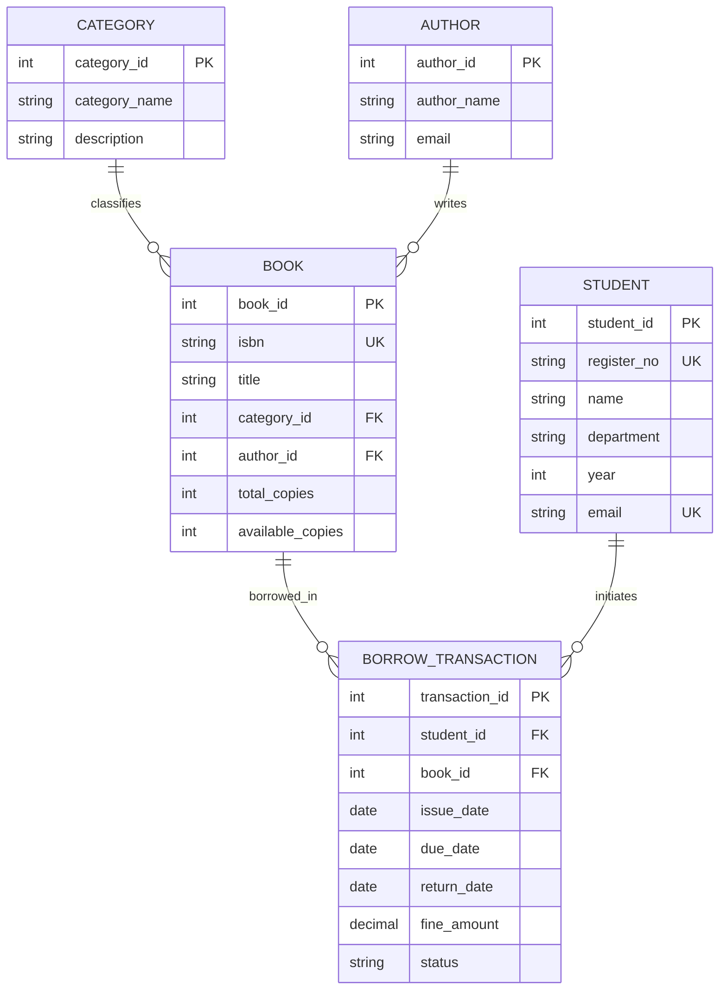

# Database Design and Normalization Document
## Library Book Lending and Usage Analysis System

---

**Academic Year:** 2026–2027 (Odd Semester)  
**Course:** `25ITT31` - Database Management Systems  
**Department:** Information Technology, Velalar College of Engineering and Technology  
**Student:** Abishek (`732925ITR004`), Class: 25IT3A  
**Scenario:** Scenario 4 — Library Book Lending and Usage Analysis System  

---

## 1. Entity-Relationship (ER) Modeling

### 1.1 Entities and Attributes
1. **CATEGORY**
   - `category_id` (PK, Integer, Auto Increment)
   - `category_name` (VARCHAR(50), Unique, Not Null)
   - `description` (TEXT)

2. **AUTHOR**
   - `author_id` (PK, Integer, Auto Increment)
   - `author_name` (VARCHAR(100), Not Null)
   - `email` (VARCHAR(100), Unique)

3. **BOOK**
   - `book_id` (PK, Integer, Auto Increment)
   - `isbn` (VARCHAR(20), Unique, Not Null)
   - `title` (VARCHAR(150), Not Null)
   - `category_id` (FK referencing `CATEGORY.category_id`)
   - `author_id` (FK referencing `AUTHOR.author_id`)
   - `total_copies` (INTEGER, Not Null, Check $\ge 0$)
   - `available_copies` (INTEGER, Not Null, Check $\ge 0$)

4. **STUDENT**
   - `student_id` (PK, Integer, Auto Increment)
   - `register_no` (VARCHAR(20), Unique, Not Null)
   - `name` (VARCHAR(100), Not Null)
   - `department` (VARCHAR(50), Not Null)
   - `year` (INTEGER, Not Null, Check between 1 and 4)
   - `email` (VARCHAR(100), Unique, Not Null)

5. **TRANSACTION (BORROW_TRANSACTION)**
   - `transaction_id` (PK, Integer, Auto Increment)
   - `student_id` (FK referencing `STUDENT.student_id`)
   - `book_id` (FK referencing `BOOK.book_id`)
   - `issue_date` (DATE, Not Null)
   - `due_date` (DATE, Not Null)
   - `return_date` (DATE, Nullable)
   - `fine_amount` (DECIMAL(6,2), Default 0.00)
   - `status` (VARCHAR(20), Check in (`'ISSUED'`, `'RETURNED'`))

### 1.2 ER Diagram (Mermaid)



### 1.3 Mapping Cardinalities
- **Category to Book:** $1 : N$ (One category contains many books; each book belongs to one primary category).
- **Author to Book:** $1 : N$ (One author writes many books; each catalog entry references its primary author).
- **Student to Transaction:** $1 : N$ (One student can execute multiple borrowing transactions over time).
- **Book to Transaction:** $1 : N$ (One book copy can be borrowed across multiple transactions across its lifetime).

---

## 2. Relational Database Schema & Keys

### 2.1 Relational Schema Notation
- `CATEGORIES` ($\underline{\text{category\_id}}$, category\_name, description)
- `AUTHORS` ($\underline{\text{author\_id}}$, author\_name, email)
- `BOOKS` ($\underline{\text{book\_id}}$, isbn, title, $\text{category\_id}^*$, $\text{author\_id}^*$, total\_copies, available\_copies)
- `STUDENTS` ($\underline{\text{student\_id}}$, register\_no, name, department, year, email)
- `TRANSACTIONS` ($\underline{\text{transaction\_id}}$, $\text{student\_id}^*$, $\text{book\_id}^*$, issue\_date, due\_date, return\_date, fine\_amount, status)

*Underlined attributes indicate Primary Keys ($\text{PK}$). Asterisks ($^*$) indicate Foreign Keys ($\text{FK}$).*

### 2.2 Integrity Constraints
- **Entity Integrity:** Every primary key (`category_id`, `author_id`, `book_id`, `student_id`, `transaction_id`) is unique and cannot contain NULL values.
- **Referential Integrity:** 
  - `BOOKS.category_id` references `CATEGORIES.category_id` (ON DELETE RESTRICT).
  - `BOOKS.author_id` references `AUTHORS.author_id` (ON DELETE RESTRICT).
  - `TRANSACTIONS.student_id` references `STUDENTS.student_id` (ON DELETE RESTRICT).
  - `TRANSACTIONS.book_id` references `BOOKS.book_id` (ON DELETE RESTRICT).
- **Domain Constraints:**
  - `available_copies` $\ge 0$ AND `available_copies` $\le$ `total_copies`.
  - `status` IN (`'ISSUED'`, `'RETURNED'`).
  - `fine_amount` $\ge 0.00$.
  - `year` BETWEEN 1 AND 4.

---

## 3. Database Normalization (UNF to BCNF)

Normalization is the process of structuring a relational database to reduce data redundancy and eliminate insertion, update, and deletion anomalies.

### 3.1 Unnormalized Form (UNF)
Consider a manual ledger representation storing all library activities in a single flat table:

$$\text{LIBRARY\_RECORD}(\text{RegNo}, \text{StudentName}, \text{Dept}, \text{BookISBN}, \text{BookTitle}, \text{AuthorName}, \text{AuthorEmail}, \text{CategoryName}, \text{IssueDate}, \text{DueDate}, \text{ReturnDate}, \text{Fine})$$

**Anomalies in UNF:**
- **Redundancy:** Every time a book is borrowed, author details, student name, and book title are duplicated.
- **Insertion Anomaly:** A new book or student cannot be added unless a borrowing transaction occurs.
- **Deletion Anomaly:** Deleting the history of a borrowing transaction deletes the record of the student or book if it was their only transaction.
- **Update Anomaly:** Updating an author's email requires modifying hundreds of transaction rows.

---

### 3.2 First Normal Form (1NF)
**Rule:** A relation is in 1NF if every attribute contains only atomic (indivisible) values and there are no repeating groups.

In the unnormalized view, if a student borrowed multiple books at once, books would be listed as a multi-valued repeating group:
- $\text{RegNo} \to \{\text{ISBN}_1, \text{ISBN}_2\}$

To achieve **1NF**, repeating groups are unnested so that every column contains scalar atomic values:
$$\text{UNF\_FLAT}(\underline{\text{RegNo}, \text{BookISBN}, \text{IssueDate}}, \text{StudentName}, \text{Dept}, \text{BookTitle}, \text{AuthorName}, \text{AuthorEmail}, \text{CategoryName}, \text{DueDate}, \text{ReturnDate}, \text{Fine})$$
Composite Primary Key: $\{\text{RegNo}, \text{BookISBN}, \text{IssueDate}\}$.

---

### 3.3 Second Normal Form (2NF)
**Rule:** A relation is in 2NF if it is in 1NF and **no non-prime attribute is partially dependent** on any candidate key (every non-prime attribute must be fully functionally dependent on the entire primary key).

**Functional Dependencies (FDs) in 1NF Relation:**
1. $\{\text{RegNo}, \text{BookISBN}, \text{IssueDate}\} \to \{\text{DueDate}, \text{ReturnDate}, \text{Fine}\}$ *(Full Dependency)*
2. $\text{RegNo} \to \{\text{StudentName}, \text{Dept}\}$ *(Partial Dependency on Composite Key)*
3. $\text{BookISBN} \to \{\text{BookTitle}, \text{AuthorName}, \text{AuthorEmail}, \text{CategoryName}\}$ *(Partial Dependency on Composite Key)*

**Decomposition into 2NF:**
We decompose the table into three distinct relations:
- `STUDENT` ($\underline{\text{RegNo}}$, StudentName, Dept)
- `BOOK_CATALOG` ($\underline{\text{BookISBN}}$, BookTitle, AuthorName, AuthorEmail, CategoryName)
- `TRANSACTION` ($\underline{\text{TransactionID}}$, $\text{RegNo}^*$, $\text{BookISBN}^*$, IssueDate, DueDate, ReturnDate, Fine)

Now, all partial dependencies are eliminated.

---

### 3.4 Third Normal Form (3NF)
**Rule:** A relation is in 3NF if it is in 2NF and **no non-prime attribute is transitively dependent** on the primary key (if $X \to Y$ and $Y \to Z$, then $Z$ must not depend transitively on $X$).

**Transitive Dependencies in `BOOK_CATALOG`:**
- $\text{BookISBN} \to \text{AuthorName}$
- $\text{AuthorName} \to \text{AuthorEmail}$ *(Transitive Dependency: $\text{BookISBN} \to \text{AuthorEmail}$ via $\text{AuthorName}$)*
- $\text{BookISBN} \to \text{CategoryName}$

**Decomposition into 3NF:**
Separate the independent entities `AUTHOR` and `CATEGORY`:
- `AUTHOR` ($\underline{\text{author\_id}}$, author\_name, email)
- `CATEGORY` ($\underline{\text{category\_id}}$, category\_name, description)
- `BOOK` ($\underline{\text{book\_id}}$, isbn, title, $\text{category\_id}^*$, $\text{author\_id}^*$, total\_copies, available\_copies)

---

### 3.5 Boyce-Codd Normal Form (BCNF)
**Rule:** A relation $R$ is in BCNF if for every non-trivial functional dependency $X \to Y$, **$X$ is a superkey**.

Let us test each decomposed table:
1. `CATEGORIES`: Functional dependency $\text{category\_id} \to \text{category\_name}$. Here, $\text{category\_id}$ is the primary key (superkey). $\checkmark$ Satisfies BCNF.
2. `AUTHORS`: Functional dependency $\text{author\_id} \to \text{author\_name}, \text{email}$. Here, $\text{author\_id}$ is the primary key. $\checkmark$ Satisfies BCNF.
3. `STUDENTS`: Functional dependencies $\text{student\_id} \to \text{register\_no}, \text{name}, \text{dept}, \text{email}$ and $\text{register\_no} \to \text{student\_id}, \dots$. Both left-hand sides are candidate keys/superkeys. $\checkmark$ Satisfies BCNF.
4. `BOOKS`: Functional dependency $\text{book\_id} \to \text{isbn}, \text{title}, \text{category\_id}, \dots$. $\text{book\_id}$ and $\text{isbn}$ are candidate keys. $\checkmark$ Satisfies BCNF.
5. `TRANSACTIONS`: Functional dependency $\text{transaction\_id} \to \text{student\_id}, \text{book\_id}, \text{issue\_date}, \dots$. $\text{transaction\_id}$ is the primary key. $\checkmark$ Satisfies BCNF.

**Conclusion:** The database schema is fully normalized up to **BCNF**, completely free of redundancy, update anomalies, insertion anomalies, and deletion anomalies.

---

## 4. Advanced Database Features Implemented

### 4.1 Indexes for Query Optimization
- `idx_books_category`: Speeds up joins and category-level borrowing aggregations.
- `idx_transactions_student`: Optimizes student borrowing history and active loan counts.
- `idx_transactions_status`: Accelerates retrieval of active and overdue records.
- `idx_transactions_issue_date`: Enhances temporal/monthly trend queries for Python analytics.

### 4.2 Analytical SQL Views
A comprehensive view `vw_circulation_analytics` is defined to flatten the normalized tables for instant read-only extraction by the Python data science engine:

```sql
CREATE VIEW vw_circulation_analytics AS
SELECT 
    t.transaction_id,
    t.issue_date,
    t.due_date,
    t.return_date,
    t.status,
    t.fine_amount,
    s.student_id,
    s.register_no,
    s.name AS student_name,
    s.department,
    s.year,
    b.book_id,
    b.isbn,
    b.title AS book_title,
    c.category_name,
    a.author_name
FROM transactions t
JOIN students s ON t.student_id = s.student_id
JOIN books b ON t.book_id = b.book_id
JOIN categories c ON b.category_id = c.category_id
JOIN authors a ON b.author_id = a.author_id;
```
