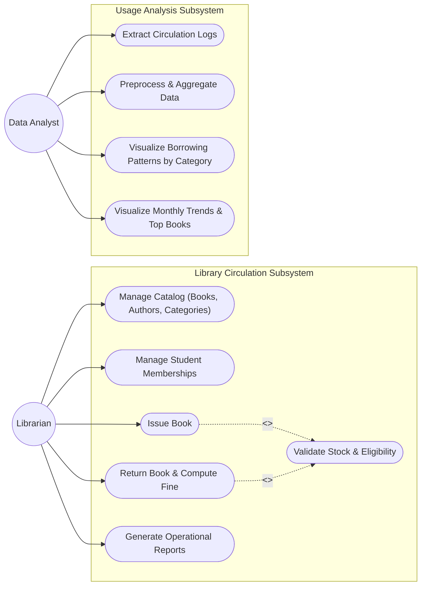
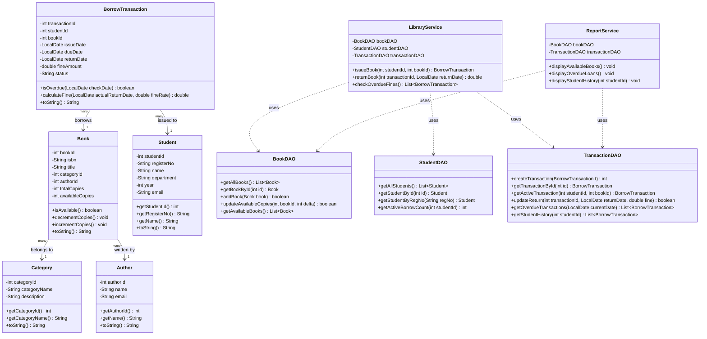
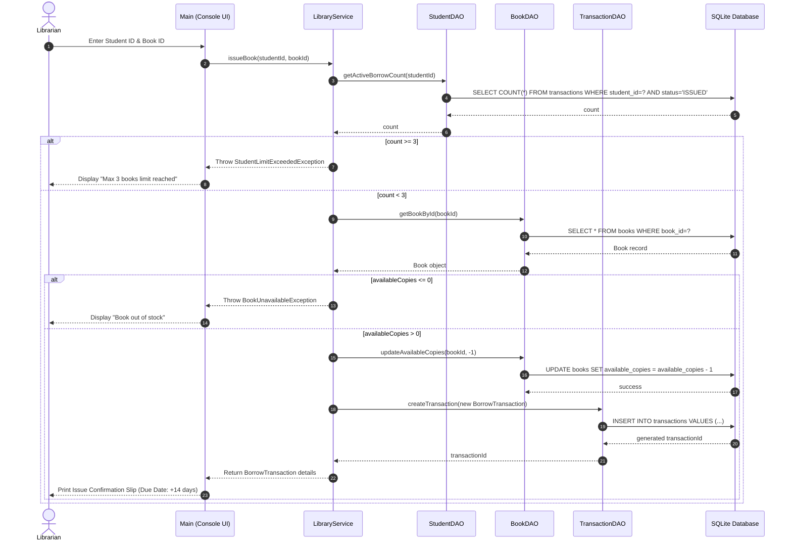
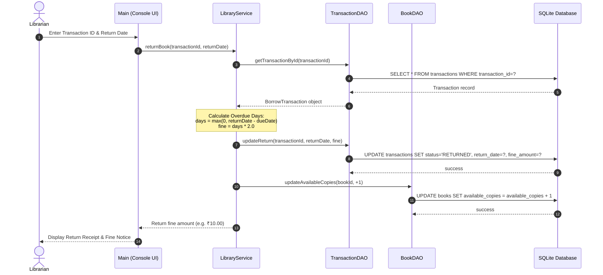

# System Design Document (SDD)
## Library Book Lending and Usage Analysis System

---

**Academic Year:** 2026–2027 (Odd Semester)  
**Course:** `25ITT33` - Software Engineering  
**Department:** Information Technology, Velalar College of Engineering and Technology  
**Author:** Abishek (`732925ITR004`), Class: 25IT3A  
**Scenario:** Scenario 4 — Library Book Lending and Usage Analysis System  

---

## 1. Architectural Design

The system implements a modular **Three-Tier Layered Architecture** with an independent **Analytical Engine**.

```
+========================================================================+
|                       PRESENTATION LAYER                               |
|   +----------------------------------------------------------------+   |
|   |             Console Menu & CLI Interface (Main.java)            |   |
|   +----------------------------------------------------------------+   |
+===================================|====================================+
                                    | (User Requests / Formatted I/O)
+===================================v====================================+
|                      APPLICATION / SERVICE LAYER                       |
|   +-------------------------+     +--------------------------------+   |
|   |     LibraryService      |     |         ReportService          |   |
|   |  - issueBook()          |     |  - getAvailableBooksReport()   |   |
|   |  - returnBook()         |     |  - getOverdueLoansReport()     |   |
|   |  - calculateFine()      |     |  - getStudentHistoryReport()   |   |
|   +-------------------------+     +--------------------------------+   |
|                               |                                        |
|   +---------------------------v------------------------------------+   |
|   |      Exception & Validation Layer (Custom Exceptions)          |   |
|   +----------------------------------------------------------------+   |
+===================================|====================================+
                                    | (DTOs / Domain Models)
+===================================v====================================+
|                       DATA ACCESS LAYER (DAO)                          |
|   +--------------------+  +--------------------+  +----------------+   |
|   |     BookDAO        |  |     StudentDAO     |  | TransactionDAO |   |
|   +--------------------+  +--------------------+  +----------------+   |
|   +----------------------------------------------------------------+   |
|   |     DatabaseConnection / SQLite Driver Manager                 |   |
|   +----------------------------------------------------------------+   |
+===================================|====================================+
                                    | (JDBC SQL Queries)
+===================================v====================================+
|                        DATA PERSISTENCE LAYER                          |
|   +----------------------------------------------------------------+   |
|   |                 SQLite Database (library.db)                   |   |
|   |  [categories] [authors] [books] [students] [transactions]      |   |
|   +----------------------------------------------------------------+   |
+===================================|====================================+
                                    | (Read-Only SQL Extraction)
+===================================v====================================+
|                    PYTHON ANALYTICS & EDA ENGINE                       |
|   +----------------------------------------------------------------+   |
|   |   sqlite3 -> Pandas DataFrame -> Data Cleaning -> Aggregation  |   |
|   |   Matplotlib / Seaborn Visualizations (.png & Jupyter Notebook)|   |
|   +----------------------------------------------------------------+   |
+========================================================================+
```

---

## 2. Use Case Modeling

### 2.1 Use Case Diagram (Mermaid)



### 2.2 Detailed Use Case Descriptions

#### Use Case UC3: Issue Book
- **Primary Actor:** Librarian
- **Preconditions:**
  1. Student is registered in the database.
  2. Book exists in the catalog.
- **Main Success Scenario:**
  1. Librarian selects "Issue Book" and inputs `Student ID` and `Book ID`.
  2. System verifies book exists and checks `available_copies > 0`.
  3. System checks the student currently holds fewer than 3 active borrowed books.
  4. System records the transaction with Issue Date = Current Date, Due Date = Current Date + 14 Days, Status = `'ISSUED'`.
  5. System decrements `available_copies` of the book by 1.
  6. System displays an issue confirmation slip with Transaction ID and Due Date.
- **Exceptions:**
  - 3a. Book is out of stock $\to$ System throws `BookUnavailableException` and aborts.
  - 3b. Student already has 3 active loans $\to$ System throws `StudentLimitExceededException` and aborts.

#### Use Case UC5: Return Book & Calculate Fine
- **Primary Actor:** Librarian
- **Preconditions:**
  - An active issue transaction exists (`status = 'ISSUED'`).
- **Main Success Scenario:**
  1. Librarian selects "Return Book" and inputs `Transaction ID` (or `Student ID` + `Book ID`).
  2. System retrieves the transaction record and checks Due Date against Return Date.
  3. If $\text{Return Date} > \text{Due Date}$, system calculates:
     $$\text{Overdue Days} = \text{Return Date} - \text{Due Date}$$
     $$\text{Fine} = \text{Overdue Days} \times ₹2.00$$
     Otherwise, $\text{Fine} = ₹0.00$.
  4. System updates the transaction status to `'RETURNED'`, records `return_date` and `fine_amount`.
  5. System increments the book's `available_copies` by 1.
  6. System displays the return summary, overdue days, and fine payable.

---

## 3. Class Diagram

### 3.1 Class Diagram (Mermaid)



---

## 4. Sequence Diagrams

### 4.1 Book Issue Sequence Diagram



### 4.2 Book Return & Fine Calculation Sequence Diagram



---

## 5. Software Engineering Design Principles Applied
1. **Separation of Concerns (SoC):** Distinct separation between models (state), DAOs (data access), services (business rules), and UI (interaction).
2. **Design for Testability:** Business logic methods (e.g. `calculateFine`) are pure algorithmic functions independent of console I/O, allowing automated unit testing.
3. **Data Integrity:** SQLite foreign keys with cascading policies guarantee referential integrity across student removals or book deletions.
